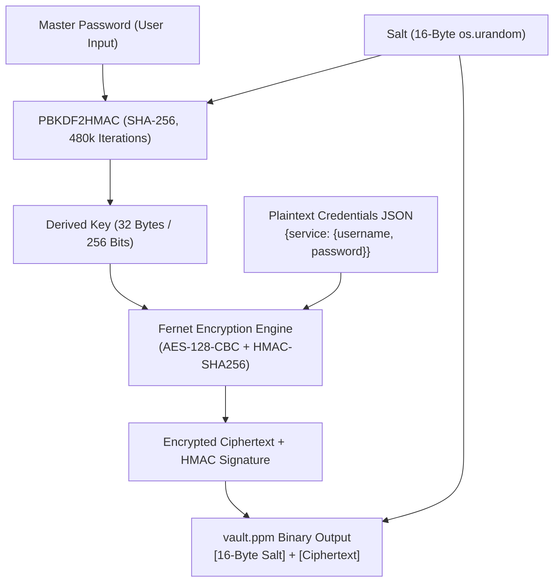

# PPM - Portable Password Manager

[](ppm.py)
[](https://www.python.org/)
[](https://cryptography.io/)
[](#)

A secure, completely offline, zero-trace command-line password manager designed for portable flash drives and removable media. **PPM** stores all encrypted credentials strictly within its host directory, leaving zero temporary files, registry keys, or footprints on host operating systems.

---

## Table of Contents

- [Key Features](#key-features)
- [Architecture & Cryptographic Design](#architecture--cryptographic-design)
  - [Cryptographic Pipeline](#cryptographic-pipeline)
  - [Storage Format (`vault.ppm`)](#storage-format-vaultppm)
  - [Portability & Zero-Trace Design](#portability--zero-trace-design)
- [Project Structure](#project-structure)
- [Installation & Prerequisites](#installation--prerequisites)
- [Usage Guide](#usage-guide)
  - [First Launch & Master Password Setup](#first-launch--master-password-setup)
  - [Menu Options](#menu-options)
  - [Importing Credentials from Browsers](#importing-credentials-from-browsers)
  - [Emergency Reset & Vault Deletion](#emergency-reset--vault-deletion)
- [Building a Standalone Executable](#building-a-standalone-executable)
- [Security Model & Threat Analysis](#security-model--threat-analysis)
- [Credits](#credits)

---

## Key Features

- **Strict USB Portability**: Dynamically detects runtime environments (standard Python or compiled PyInstaller single binary) to ensure the vault file stays adjacent to the executable, never spilling into host temp folders.
- **Industry-Standard Cryptography**: Authenticated encryption powered by Python's `cryptography` library implementing Fernet (AES-128 in CBC mode with HMAC-SHA256 authentication).
- **Hardened Key Derivation**: PBKDF2HMAC using SHA-256 with **480,000 iterations** and a fresh, cryptographically secure 16-byte random salt on every save.
- **Rich Terminal UI**: Clean ASCII banner, formatted tables, color-coded status indicators, and masked password inputs via `rich` and `getpass`.
- **Browser CSV Importer**: Automatically detects password exports in `Desktop` and `Downloads` folders (Chrome, Edge, Brave, etc.) or accepts custom file paths.
- **Search & Display**: Rapid substring search across services and usernames, plus a dedicated full-vault viewer.
- **Fail-Safe Recovery Safeguards**: Guardrails against accidental data loss with explicit confirmation keywords (`WIPE` and `DELETE`).

---

## Architecture & Cryptographic Design

### Cryptographic Pipeline

PPM adheres to an authenticated symmetric encryption design. The master password is never stored anywhere on disk or transmitted across any network.



1. **Key Derivation (PBKDF2HMAC-SHA256)**:
   - When encrypting or decrypting, the master password is provided to `PBKDF2HMAC`.
   - Iteration count is fixed at **480,000**, significantly raising the computational cost of offline brute-force and dictionary attacks.
   - A 16-byte cryptographically secure pseudorandom salt (`os.urandom(16)`) ensures identical master passwords produce entirely distinct encryption keys across saves.
2. **Authenticated Encryption (Fernet)**:
   - Fernet utilizes 128-bit AES in CBC mode with PKCS7 padding.
   - Authenticated using HMAC-SHA256 with a 128-bit key to ensure integrity and prevent ciphertext tampering.
   - Any modification to the encrypted binary or an incorrect master password triggers an authentication failure and immediately rejects access.

### Storage Format (`vault.ppm`)

The vault is persisted as a single compact binary file without relying on external database engines:

```
+--------------------------+-------------------------------------------------+
|   Bytes 0 .. 15 (16 B)   |               Bytes 16 .. N (Variable)          |
+--------------------------+-------------------------------------------------+
|   Random Salt (Binary)   |   Fernet Encrypted Payload (JSON serialized)    |
+--------------------------+-------------------------------------------------+
```

### Portability & Zero-Trace Design

When packaged as a PyInstaller single executable (`--onefile`), standard Python scripts often point `__file__` to temporary extraction directories (e.g., `%TEMP%\_MEIxxxxxx`). PPM avoids this common pitfall by checking execution state:

```python
if getattr(sys, 'frozen', False):
    APP_DIR = os.path.dirname(sys.executable)
else:
    APP_DIR = os.path.dirname(os.path.abspath(__file__))

VAULT_FILE = os.path.join(APP_DIR, "vault.ppm")
```

This guarantees `vault.ppm` resides strictly alongside the executable (such as directly on a USB flash drive), leaving no data behind when detached.

---

## Project Structure

```
Portable Password Manager/
├── ppm.py            # Primary application source code
├── ppm.spec          # PyInstaller build specification
├── vault.ppm         # Encrypted vault file (generated on first save)
├── .gitignore        # Repository ignore rules (excludes vault and build artifacts)
└── README.md         # Project documentation
```

---

## Installation & Prerequisites

### Prerequisites

- Python 3.10 or higher
- Pip package manager

### Required Dependencies

Install the required Python libraries using `pip`:

```bash
pip install cryptography rich pyinstaller
```

---

## Usage Guide

### First Launch & Master Password Setup

Run the application using Python:

```bash
python ppm.py
```

- If no `vault.ppm` file exists, you will be prompted to create your **Master Password**.
- The master password is encrypted immediately with a freshly generated salt.
- Keep this master password safe. It cannot be recovered without a wipe if forgotten.

### Menu Options

```
[1] 🔍 Search Passwords
[2] 📋 Show All Passwords
[3] ➕ Add New Password
[4] 📥 Import from Browser CSV
[5] ⚠️  Reset Master Password (WIPES VAULT)
[6] ❌ Delete Vault Entirely
[7] ℹ️  Credits & Info
[8] 🚪 Lock & Exit
```

1. **Search Passwords (`[1]`)**:
   - Queries entries by service name or username (case-insensitive substring match).
   - Pressing Enter with a blank query lists all matches.
2. **Show All Passwords (`[2]`)**:
   - Renders all credentials stored in the vault in a formatted Rich table.
3. **Add New Password (`[3]`)**:
   - Prompts for `Service/URL`, `Username`, and masked `Password`.
   - Immediately commits the updated credentials to the encrypted vault.
4. **Import from Browser CSV (`[4]`)**:
   - Scans system `Downloads` and `Desktop` for common browser password export filenames.
   - Alternatively allows manual path input.
5. **Reset Master Password (`[5]`)**:
   - Wipes all vault data and allows setting a new master password.
   - Requires explicit verification typing `WIPE`.
6. **Delete Vault Entirely (`[6]`)**:
   - Permanently removes `vault.ppm` from the drive.
   - Requires explicit verification typing `DELETE`.
7. **Credits & Info (`[7]`)**:
   - Displays developer credits and architectural background.
8. **Lock & Exit (`[8]`)**:
   - Clears memory and exits the program cleanly.

### Importing Credentials from Browsers

PPM supports importing standard CSV password exports from Chromium-based browsers (Chrome, Edge, Brave, Opera) and Firefox:

1. In your browser settings, export your saved passwords as a `.csv` file.
2. Launch PPM and choose option `[4] 📥 Import from Browser CSV`.
3. PPM will detect the export file automatically, or you can enter the path manually.
4. Once imported, delete the plaintext CSV file from your disk to protect your credentials.

### Emergency Reset & Vault Deletion

- **Startup Reset**: If you forget your master password, type `RESET` at the initial master password prompt. You will be prompted to type `WIPE` to clear the vault and start fresh.
- **Drive Cleanliness**: Option `[6]` removes `vault.ppm` completely if you need to decommission or sanitize the flash drive.

---

## Building a Standalone Executable

To compile PPM into a single self-contained `.exe` binary for Windows:

```powershell
pyinstaller ppm.spec
```

Or build directly using PyInstaller arguments:

```powershell
pyinstaller --onefile --console --name ppm ppm.py
```

The resulting binary will be located in the `dist/` directory:
- Copy `dist/ppm.exe` onto any USB flash drive.
- No Python runtime or third-party dependencies are required on the host system.

---

## Security Model & Threat Analysis

| Threat Vector | Mitigation Strategy in PPM |
| :--- | :--- |
| **Offline Vault Theft** | The entire payload is encrypted with AES-128-CBC and authenticated with HMAC-SHA256. 480,000 PBKDF2 iterations deter brute-force and rainbow table attacks. |
| **Data Tampering & Bit-Flipping** | Fernet enforces HMAC-SHA256 integrity verification. Tampered bytes cause decryption to immediately abort without exposing plaintext. |
| **Shoulder Surfing** | Passwords and master credentials use masked console inputs (`getpass`). |
| **Host Disk Artifacts** | Zero temporary files, cache entries, or registry keys are written to host directories. All data remains in memory and writes directly to `vault.ppm`. |
| **Plaintext RAM Exposure** | Decrypted data exists only during an active session in local memory. Locking/exiting clears the process scope. |

> [!IMPORTANT]
> **Best Practices for USB Storage:**
> - Ensure your USB drive is kept physically secure.
> - Always delete any unencrypted browser `.csv` export files after importing them into PPM.
> - Maintain an encrypted offline backup of your `vault.ppm` file.

---

## Credits

- **Lead Developer**: Pratyush
- **Core Technologies**: Python, [Cryptography](https://cryptography.io/), [Rich](https://github.com/Textualize/rich), [PyInstaller](https://pyinstaller.org/)
